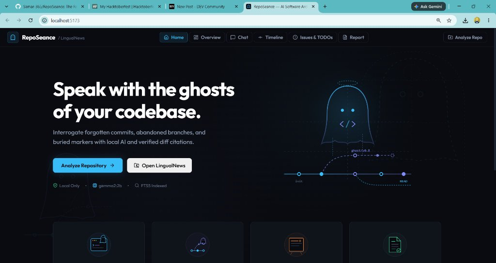
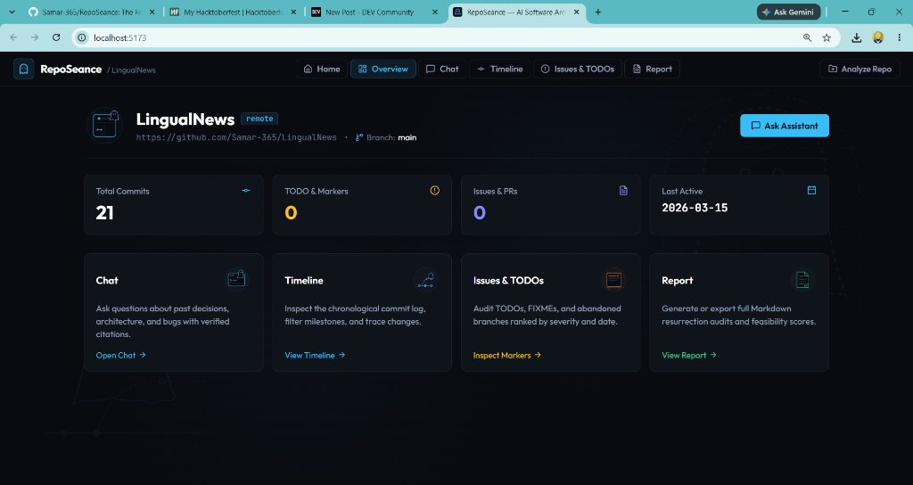
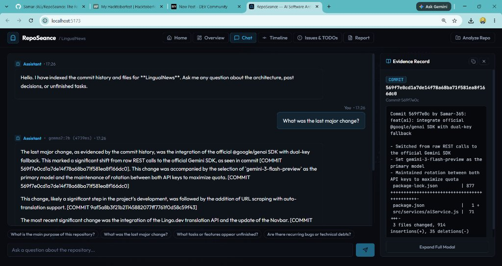
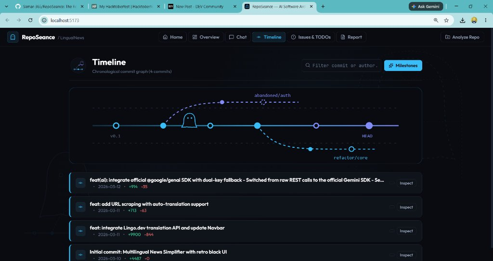
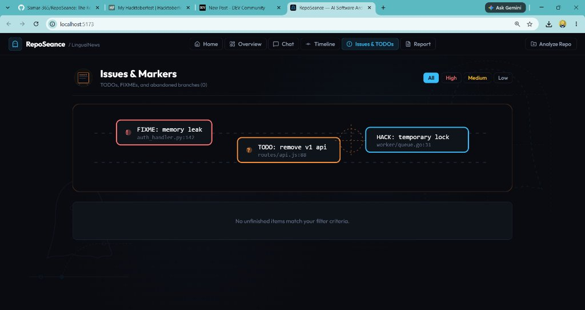
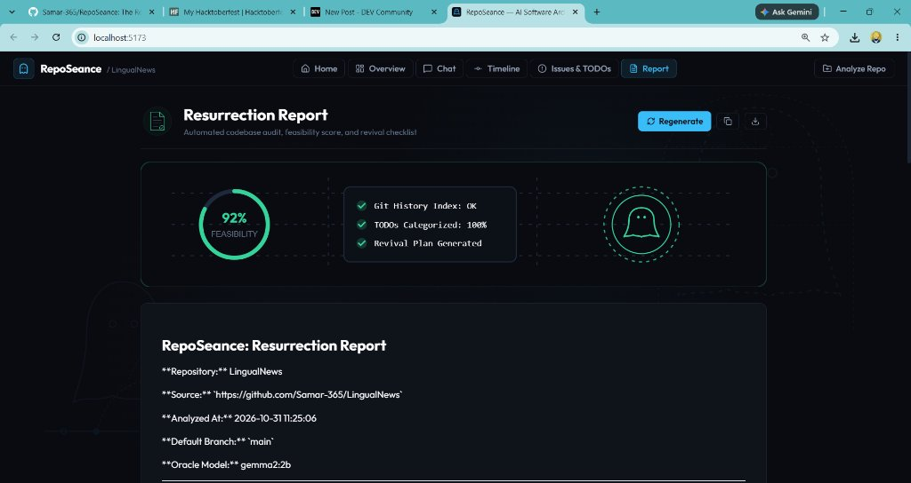

# Hacktoberfest 2026 Week 4 Submission Draft: RepoSeance

> **Challenge:** Ghost in the Machine  
> **Author:** Samar Shetye (@samar_shetye)  
> **Repository:** https://github.com/Samar-365/RepoSeance  
> **Demo Video:** https://youtu.be/K178dm6TmvY  
> **DevRelay Session ID:** 1320 (`building-reposeance-local-software-archaeology-with-gemma-2-kur6xe`)  
> **Session URL:** https://dev.to/agent_sessions/building-reposeance-local-software-archaeology-with-gemma-2-kur6xe  
> **Submission URL:** https://dev.to/new?prefill=...

---

```markdown
---
title: RepoSeance: Resurrecting Dead Code with Local Open-Weight AI
published: true
tags: devchallenge, hf26challenge, gemma, opensource
---

*This is a submission for the [Hacktoberfest Open-Source AI Challenge Week 4: Ghost in the Machine](https://dev.to/challenges/hacktoberfest-week4-2026-10-26)*

---


## What I Built

Every software engineer inherits a codebase that feels haunted.

You clone an archived repository or checkout an unfamiliar branch, and you are immediately greeted by the restless spirits of past developers: cryptic `// TODO: fix this before Friday` comments written five years ago, half-implemented refactors abandoned mid-stride, and git commit messages like *"wip: it works on my machine"*. 

Usually, the institutional knowledge died when the original authors left the company or archived the repository. 

**RepoSeance** is an open-source, local-first software archaeology tool. Rather than treating legacy or abandoned repositories as landfill, RepoSeance conducts a digital séance over your git history. It reconstructs project chronology, indexes unmerged branch inflection points, scans for orphaned `TODO`/`FIXME` markers, and summons an interactive, evidence-grounded AI assistant powered completely offline by **Google's open-weight Gemma 2 model**.

Ask RepoSeance why a module was rewritten, what features were abandoned, or where the riskiest architectural debt lies—and it will answer you with verified citations linking to exact commit SHAs, line numbers, and author timestamps.

---

## Demo



*Watch the 2-minute walkthrough: [YouTube Demo Link](https://youtu.be/K178dm6TmvY)*

### Screenshots Walkthrough

#### 1. Minimalist Landing Page

*Minimalist interface with bespoke vector art, single-click repository presets, and zero cloud tracking.*

#### 2. Repository Overview & Health Telemetry

*Real-time breakdown of ingested commits, code markers, active branches, and last commit dates.*

#### 3. Grounded Chat & Side Evidence Drawer (Hero Feature)

*Gemma 2 answers complex architectural queries with verifiable citations. Clicking any commit SHA (`569f7e0...`) opens the exact diff and author metadata in the side inspector.*

#### 4. Ghost Timeline & Milestone Inflection Points

*Interactive commit visualizer separating routine maintenance from significant milestone refactors and abandoned branch points.*

#### 5. Issues & Marker Archaeology

*Automated excavation of abandoned branches, FIXMEs, and TODO markers ranked by severity and commit age.*

#### 6. Automated Resurrection Report & Feasibility Codex

*Automated engineering audit synthesized by Gemma 2 featuring a 92% feasibility gauge, verified architecture checklist, and exportable Markdown revival plan.*

---

## Code



*Source repository: [github.com/Samar-365/RepoSeance](https://github.com/Samar-365/RepoSeance)*

---

## How I Built It

RepoSeance is built around a **100% open-source, offline AI stack**:

```
Frontend: React 19 + Vite (Minimalist Dark Theme & Bespoke SVG Visuals)
        │
        ▼ (REST API)
Backend: Flask Application (Python 3.11)
        │
        ├── Ingestion: GitPython (commit churn, reflog & branch analysis)
        ├── AST Parser: Source scanner for TODO / FIXME / HACK markers
        ├── Storage: SQLite with FTS5 (BM25 full-text search index)
        └── Local AI Engine: Ollama running open-weight Gemma 2:2b
```

### The Grounding Pipeline
When a user asks: *"What was the last major change?"*, RepoSeance does not blindly prompt an LLM:
1. **Local Retrieval**: It executes a BM25 ranked search across SQLite FTS5 commit tables, commit messages, file diffs, and issue logs.
2. **Context Assembly**: The top surviving records are injected into a structured grounding prompt.
3. **Local Inference**: **Gemma 2 (`gemma2:2b`)** processes the grounded context via Ollama with strict system instructions to cite only surviving artifacts.
4. **Citation Extraction**: The backend parses commit SHAs and file paths from Gemma's output and renders clickable inspector pills in the frontend.

---

## Why Does Open Innovation Matter?

Open-source and open-weight AI weren't just nice-to-haves for this project—they were the foundational prerequisite. Here is why open innovation made RepoSeance possible where closed APIs fall short:

### 1. Proprietary Codebases Never Leave Your Machine
Most production repositories contain proprietary business logic, sensitive internal architecture, or compliance-restricted code. Sending your entire git log and diff history to third-party cloud APIs is an immediate security dealbreaker for most engineering teams. Because Gemma 2 runs entirely locally via Ollama, **zero bytes of code or prompt context ever leave your laptop**.

### 2. Works With the Lights (and the Internet) Off
Software archaeology often happens on airplanes, in server rooms with air-gapped networks, or during outages. RepoSeance has zero external cloud dependencies. You can clone an archived repo into a cabin in the woods with no Wi-Fi, run `reposeance`, and interrogate years of engineering history seamlessly.

### 3. Longevity & Zero Marginal Cost
Closed AI services deprecate endpoints, change rate limits, and charge per million tokens. Running a deep audit over a 10,000-commit repository on a metered cloud API could cost tens of dollars per run. With local open-weight Gemma, you can re-index and query codebases indefinitely for **$0.00**.

---

## My Agent Session



*Full session transcript published with DevRelay: [View Agent Session](https://dev.to/agent_sessions/building-reposeance-local-software-archaeology-with-gemma-2-kur6xe)*

---

## The Spirit of It

In Mexican tradition, *Día de los Muertos* is not a day of mourning, but an act of remembrance—a belief that someone only truly disappears when their stories are no longer told. 

Software development has an unfortunate habit of treating past code with cynicism. We scoff at legacy systems, call older code "spaghetti", and rewrite systems from scratch without understanding the hard-learned lessons that shaped them.

RepoSeance was built to honor the past. It gives voice to the developers who wrote code at 2 AM five years ago to keep a service alive, preserves their context, and treats their unfinished ambitions with respect. It turns a graveyard of dead commits into an ofrenda of engineering wisdom.

---

## Prize Categories

- **Featured Category: Best Use of Gemma ($200)**: Powered locally by Google's open-weight `gemma2:2b` model for grounding, architectural Q&A, and resurrection report synthesis.
- **Partner Category: Best Use of Entire ($100)**: Full agent session transcript published and embedded via DevRelay (``).
- **Top Prize**: Complete submission for Hacktoberfest Week 4 *Ghost in the Machine*.
```
